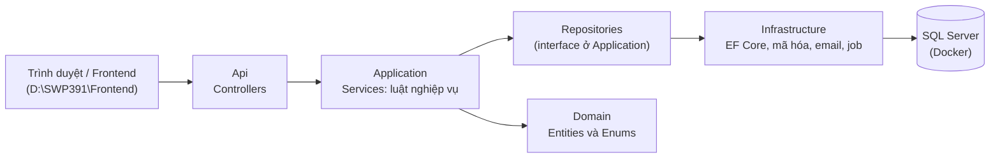
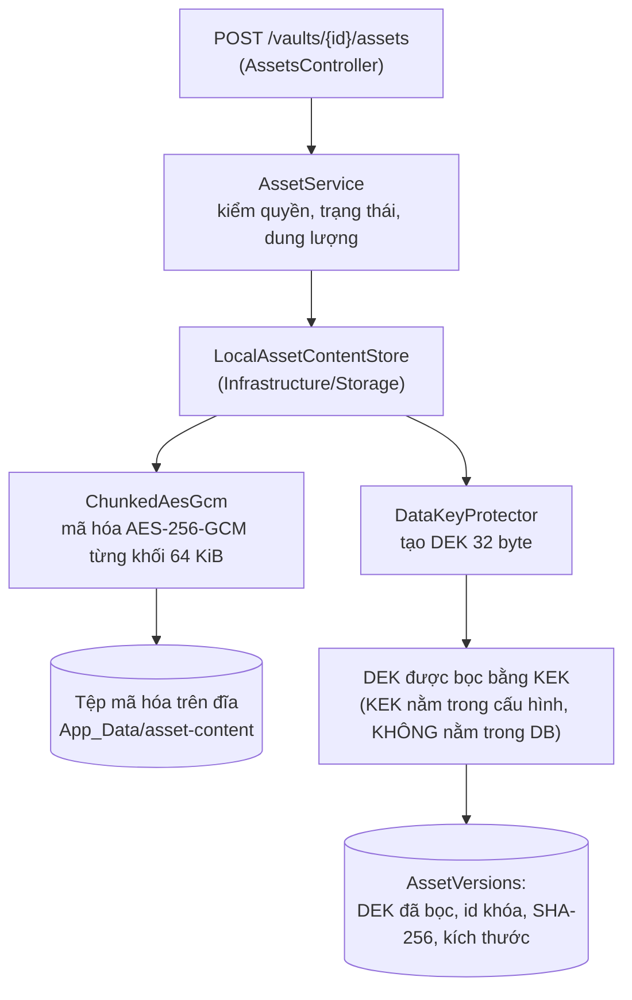
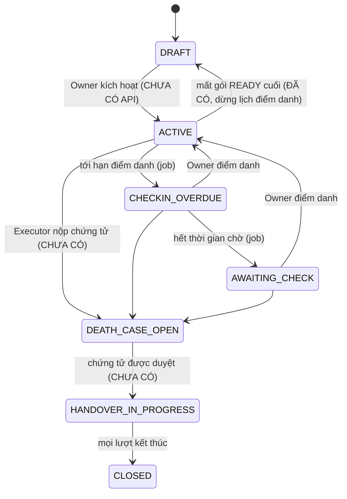
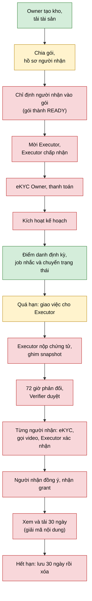

# Hiểu dự án LegacyVault: dự án làm gì và mã nguồn nằm ở đâu

Tài liệu này dành cho người mới vào dự án. Đọc theo thứ tự: (1) dự án làm gì, (2) mã nguồn tổ chức thế nào, (3) mỗi tính năng nằm ở file nào, (4) cái gì đã làm và chưa làm, (5) các vấn đề đã phát hiện, (6) cách chạy và kiểm tra.

Căn cứ: `LegacyVault-SRS-v3.15.0.md` (nghiệp vụ), `BE-FEATURE-API-HANDOFF.md` (phân công), và chính mã nguồn trong repo này. Ngày lập: 14/10/2026.

---

## 1. Dự án làm gì (nói đơn giản)

**LegacyVault là một "két sắt số" có tính năng bàn giao cho người thân khi chủ két qua đời.**

Hình dung một người (gọi là **Owner**, chủ kho) muốn để lại cho gia đình mật khẩu tài khoản, giấy tờ nhà đất, lời nhắn... Họ:

1. **Tạo kho** và **tải tài sản lên**. Hệ thống **mã hóa** nội dung trước khi lưu.
2. Chia tài sản thành các **gói bàn giao** và chỉ định **người nhận** cho từng gói.
3. Mời một người tin cậy làm **Executor** (người thực hiện) để sau này xử lý thủ tục.
4. **Điểm danh định kỳ** (mặc định 30 ngày một lần) để hệ thống biết họ vẫn ổn. Đây là tính năng *deadman switch* ("công tắc người chết").
5. Nếu Owner **ngừng điểm danh**, hệ thống không tự mở kho. Nó chỉ **giao việc cho Executor liên hệ kiểm tra**.
6. Khi Owner mất thật, Executor nộp **giấy chứng tử**. Nhân viên duyệt (**Verifier**) sau 72 giờ cho Owner kịp phản đối ("Tôi còn sống").
7. Sau khi chứng tử được duyệt, **từng người nhận** phải chứng minh đúng là người được chỉ định (eKYC + gọi video với Executor), rồi bấm đồng ý nhận. Họ được **xem và tải trong 30 ngày**.
8. Dữ liệu hết hạn lưu thì bị **xóa theo quy tắc**.

Ba nguyên tắc xuyên suốt của SRS: **không ai tự mở kho** (kể cả Admin), **mọi quyết định có người chịu trách nhiệm và có nhật ký**, **mọi hạn thời gian do server quyết định**.

### Các luồng nghiệp vụ trong SRS

| Mã | Tên | Nói đơn giản |
|---|---|---|
| F1 | Tài khoản và thiết lập kho | Đăng ký, tạo kho, tải tài sản, chia gói, chỉ định người nhận, mời Executor, kích hoạt kế hoạch |
| F2A | Điểm danh | Owner điểm danh; quá hạn thì giao việc cho Executor |
| F2B | Nộp và duyệt chứng tử | Executor nộp, Verifier duyệt sau 72 giờ |
| F2C | Owner báo còn sống | Owner phản đối hồ sơ chứng tử |
| F3 | Xác minh người nhận và bàn giao | eKYC, gọi video, đồng ý nhận, tải 30 ngày, xóa dữ liệu |
| F4 | Xử lý sự cố | Admin xử lý lỗi, giữ dữ liệu |
| P | Thanh toán | Mua dịch vụ qua SePay; Free chỉ có 20 MiB |

---

## 2. Mã nguồn tổ chức thế nào

Thư mục chính: `D:\SWP391\Backend` (repo Git). Có 4 project, mỗi project một nhiệm vụ. Một yêu cầu HTTP đi qua các lớp theo thứ tự:



| Project | Vai trò | Quy tắc |
|---|---|---|
| `src/LegacyVault.Domain` | Các bảng (entity) và danh sách trạng thái (enum) | Không phụ thuộc gì |
| `src/LegacyVault.Application` | **Luật nghiệp vụ**: services, DTO, interface của repository | Không biết SQL, HTTP hay email cụ thể |
| `src/LegacyVault.Infrastructure` | Làm việc với thế giới bên ngoài: SQL (EF Core), mã hóa, lưu file, gửi email, job nền | Cài đặt các interface của Application |
| `src/LegacyVault.Api` | Cổng vào HTTP: controllers, cấu hình, xác thực | Controller mỏng, chỉ gọi service |
| `tests/LegacyVault.IntegrationTests` | Kiểm thử | Một phần chạy trên SQL Server thật |

Cách đọc một tính năng: bắt đầu từ **Controller** (có những URL nào), sang **Service** (luật nghiệp vụ), sang **Repository** (truy vấn), cuối cùng **Entity** (bảng dữ liệu).

Quy ước code của dự án: không dùng toán tử ba ngôi; viết kiểu dễ đọc cho người quen Java (constructor và field rõ ràng, `if/else`); chú thích tiếng Việt.

---

## 3. Tính năng ↔ SRS ↔ mã nguồn

Ký hiệu: Xong = đã chạy và có test; Một phần = có nền nhưng thiếu; Chưa = chưa có.

| Tính năng | Mã SRS | Trạng thái | Controller | Service chính | Entity / bảng |
|---|---|---|---|---|---|
| Đăng ký, xác minh email, đăng nhập, phiên (JWT + refresh cookie) | AUTH | Xong | `AuthController` | `AuthService`, `RegistrationService`, `LoginSessionIssuer`, `LoginThrottleGuard` | `User`, `RefreshToken`, `EmailVerificationToken`, `LoginThrottle` |
| Đăng nhập Google, liên kết tài khoản | AUTH-02 | Xong | `GoogleAuthController` | `GoogleAuthService` | `ExternalLogin`, `ExternalLoginLinkTicket` |
| Kho (tạo, xem, sửa) | SETUP-12 | Xong | `VaultsController` | `VaultService`, `VaultRules` | `Vault`, `HandoverPlan`, `VaultEntitlement` |
| Tài sản: tải lên và **mã hóa** | ASSET, SEC-02 | Một phần: chưa có tải xuống, sửa, xóa | `AssetsController` | `AssetService` | `Asset`, `AssetVersion` |
| Gói bàn giao | SETUP-03, 16 | Một phần: chưa có chỉ định nên gói luôn `DRAFT` | `ContainersController` | `ContainerService`, `ContainerRules`, `PlanRules` | `Container`, `ContainerAsset` |
| Hồ sơ người nhận (mã hóa) | QUOTA-03/04 | Một phần: chưa có chỉ định theo gói | `BeneficiariesController` | `BeneficiaryService`, `BeneficiaryRules` | `Beneficiary` |
| **Điểm danh (deadman switch)** | F2A, DMS-01..06 | Xong phần lõi | `CheckInsController` | `CheckInService`, `CheckInJob`, `CheckInScheduler`, `CheckInTimeline` | `CheckInSchedule`, `CheckInPeriod`, `CheckInReminder` |
| Gửi email thật (Gmail) | OPS-04 | Xong, cần cấu hình | không có | `SmtpMailSender` (Infrastructure) | không có |
| Kích hoạt kế hoạch | SETUP-01 | **Chưa** | | | |
| Mời và chấp nhận Executor | SETUP-20 | **Chưa** | | | |
| Chứng tử, duyệt 72 giờ, báo còn sống | F2B, F2C | **Chưa** | | | |
| eKYC, lịch gọi video | EKYC, F3 | **Chưa** | | | |
| Đồng ý nhận, grant, tải 30 ngày, xóa dữ liệu | F3 | **Chưa** | | | |
| Thanh toán SePay | P | **Chưa** | | | |
| Admin, sự cố, nhật ký | F4 | **Chưa** | | | |

### 3.1. Đăng nhập (đã có)

- URL: `POST /api/v1/auth/register`, `verify-email`, `resend-verification`, `login`, `refresh`, `logout`, `GET session`; `POST /api/v1/auth/google`, `google/link-confirm`.
- Access token (JWT, sống 15 phút) nằm trong JSON; refresh token nằm trong cookie HttpOnly.
- Mật khẩu băm Argon2id: `Infrastructure/Security/Argon2PasswordHasher.cs`.
- JWT: `JwtTokenService.cs`; người đang gọi API: `CurrentUser.cs`.

### 3.2. Kho và gói (đã có)

- `POST /api/v1/vaults` (tạo, bấm lặp vẫn một kho), `GET /vaults/me`, `PUT /vaults/{id}` (có etag chống ghi đè).
- Mỗi kho đi kèm **một kế hoạch** (`HandoverPlan`, bắt đầu `DRAFT`) và **một quyền dịch vụ** (`VaultEntitlement`, Free 20 MiB).
- Gói: `GET/POST/PUT/DELETE /api/v1/vaults/{id}/containers`, thêm/gỡ tài sản trong gói. Xóa gói thật ra là **lưu trữ**.
- Luật trạng thái kế hoạch nằm ở `PlanRules.cs`; luật "kho có cho sửa không" ở `VaultRules.cs`.

### 3.3. Tài sản và mã hóa (đã có, phần tôi làm)

Đường đi của một tệp tải lên:



- Mỗi phiên bản nội dung có **một khóa riêng (DEK)**; DEK được bọc bằng **KEK** lấy từ cấu hình `AssetEncryption`. Lộ database mà không có KEK thì không đọc được nội dung.
- KEK dev có sẵn trong `appsettings.Development.json` (chỉ dùng local). Server thật phải đặt bằng biến môi trường.
- Đổi KEK: thêm khóa mới, chuyển `ActiveKeyId`, **giữ khóa cũ** để còn mở được dữ liệu cũ.
- File chính: `ChunkedAesGcm.cs` (mã hóa theo khối), `DataKeyProtector.cs` (bọc/mở DEK), `LocalAssetContentStore.cs` (ghi và đọc tệp).

### 3.4. Điểm danh, deadman switch (đã có phần lõi)

**Vòng đời kế hoạch** (đây là điều quan trọng nhất cần hiểu):



**Một kỳ điểm danh** (mặc định chu kỳ 30 ngày, chờ 7 ngày):

| Mốc | Việc xảy ra |
|---|---|
| Ngày 0 | Bắt đầu kỳ (lúc kích hoạt hoặc lúc Owner điểm danh) |
| Ngày 23 | Email nhắc 1: còn 7 ngày |
| Ngày 29 | Email nhắc 2: còn 1 ngày |
| Ngày 30 | Tới hạn: kế hoạch sang `CHECKIN_OVERDUE`; email nhắc 3 |
| Ngày 35 | Email nhắc 4: còn 2 ngày chờ |
| Ngày 37 | Hết thời gian chờ: kế hoạch sang `AWAITING_CHECK`, ghi `AwaitingCheckAt` (để Executor nhận việc) |

Mỗi mốc nhắc chỉ gửi **một lần** cho mỗi kỳ (có ràng buộc unique trong DB). Điểm danh ở bất kỳ lúc nào trong ba trạng thái đang chạy đều đưa kế hoạch về `ACTIVE` và mở kỳ mới.

Ba API:

| URL | Việc |
|---|---|
| `GET /api/v1/check-ins/me` | Trạng thái, các hạn, cấu hình, lịch sử các kỳ. Trạng thái tính theo giờ server, **không chờ job** |
| `POST /api/v1/check-ins` | "Điểm danh ngay": đóng kỳ cũ, mở kỳ mới, trong một giao dịch |
| `PATCH /api/v1/vaults/me/check-in-settings` | Chọn chu kỳ 30/60/90 ngày và thời gian chờ 7/14/30 ngày; áp dụng từ kỳ sau |

Các file và vai trò:

| File | Làm gì |
|---|---|
| `Application/Services/CheckInTimeline.cs` | Tính giờ: hạn, trạng thái hiệu lực, 4 mốc nhắc. Hàm thuần, không đụng DB |
| `Application/Services/CheckInService.cs` | Phục vụ 3 API ở trên |
| `Application/Services/CheckInJob.cs` | Việc nền: chuyển trạng thái quá hạn, gửi nhắc mốc mới nhất |
| `Application/Services/CheckInScheduler.cs` | Cho module khác gọi: mở kỳ đầu, dừng lịch |
| `Infrastructure/Jobs/CheckInMonitor.cs` | Vòng lặp nền quét DB mỗi 60 giây, mỗi kỳ một DbContext riêng |
| `Domain/Entities/CheckIn*.cs` | Ba bảng: cấu hình lịch, từng kỳ, từng lời nhắc |
| `Infrastructure/Data/Migrations/*_AddCheckIn.cs` | Tạo ba bảng |

Hai chống ghi đè quan trọng: bảng `CheckInPeriods` có **`RowVersion`** (điểm danh và job không đè nhau) và chỉ cho **một kỳ đang mở** mỗi kế hoạch.

### 3.5. Email (đã có, cần cấu hình)

- `Infrastructure/Notifications/SmtpMailSender.cs` gửi thư qua Gmail bằng MailKit.
- Gửi email xác minh tài khoản (`SmtpEmailSender`) và email nhắc điểm danh (`SmtpCheckInReminderSender`).
- **Chưa cấu hình `Email:Smtp:UserName`/`Password` thì chỉ ghi log, không gửi thật.** Dòng log đầu tiên khi API khởi động cho biết đang ở chế độ nào.
- Cách cấu hình: README mục 11.

---

## 4. Toàn cảnh quy trình bàn giao và phần đã có



Xanh = đã có. Vàng = có một phần. Đỏ = chưa có.

**Điều cần nhớ:** hiện tại chỉ có *phần đầu* (chuẩn bị kho) và *công tắc điểm danh*. Hầu hết quy trình bàn giao (từ kích hoạt tới xóa dữ liệu) chưa có. Và vì **không có API "chỉ định người nhận"**, gói không bao giờ thành `READY`, nên **kế hoạch chưa thể được kích hoạt bằng cách hợp lệ**. Khi thử, phải đặt `Status = 'Active'` trực tiếp bằng SQL (xem `http/checkin-dev.sql`).

---

## 5. Vấn đề đã phát hiện khi rà quy trình bàn giao

Mức độ: **Cao** = chặn nghiệp vụ hoặc có thể gây sai trạng thái; **Trung bình** = lệch SRS hoặc rủi ro bảo mật cần sửa trước khi chạy thật; **Thấp** = ghi nhận.

### 5.0. Kết quả chạy kiểm tra (14/10/2026)

| Kiểm tra | Kết quả |
|---|---|
| Build Backend (Release, build lại toàn bộ) | Thành công, 0 lỗi, 0 cảnh báo |
| Test Backend (có SQL Server thật) | **213/213 qua**, không test nào bị bỏ qua |
| Model EF so với migration | Không lệch (`has-pending-model-changes`: không có thay đổi) |
| Gói NuGet có lỗ hổng đã biết | Không còn (xem 5.3) |
| Test Frontend (`node --test tests/client.test.mjs`) | **14/14 qua** |
| Build Frontend (Vite) | Thành công |
| Chạy thật trên trình duyệt (trang Điểm danh, API và DB thật) | Hoạt động đúng: chưa bắt đầu, điểm danh, đếm ngược, đổi cấu hình, quá hạn, job nền chuyển trạng thái |

**Kết luận: không có lỗi làm hỏng chương trình.** Các vấn đề dưới đây là rủi ro và phần còn thiếu so với SRS, không phải lỗi đang xảy ra. Lưu ý: build Debug có thể báo lỗi "file đang được dùng" nếu API đang chạy và khóa DLL; đó là do môi trường, build bằng `-c Release` hoặc tắt API trước.

### 5.1. Cần quyết định ở cấp nhóm

| # | Mức | Vấn đề | Căn cứ | Đề xuất |
|---|---|---|---|---|
| A1 | **Cao** | **Gmail SMTP không báo được "đã giao".** Đồng hồ 72 giờ phản đối chứng tử và 5 ngày phản hồi lời mời chỉ bắt đầu khi có kênh báo *đã giao* (nhà cung cấp xác nhận tới hộp thư). SMTP chỉ cho biết "máy chủ đã nhận". Vì vậy các đồng hồ này không thể bắt đầu đúng theo SRS. | OPS-04, DEATH-08, INVITE-04 | Chọn nhà cung cấp có webhook trạng thái giao (SendGrid, Mailgun, Amazon SES...) **hoặc** nhóm chính thức chấp nhận "SMTP nhận thư" thay "đã giao" và sửa SRS. Gmail vẫn ổn cho thử nghiệm |
| A2 | **Cao** | **Đường găng:** không có API chỉ định người nhận, nên gói không thể `READY`; không `READY` thì không kích hoạt kế hoạch; không kích hoạt thì không có điểm danh thật, chứng tử, bàn giao. Các test hiện tạo gói `READY` và kế hoạch `ACTIVE` bằng SQL. | `ContainerRules.cs`, SETUP-01, SETUP-16 | Làm theo thứ tự: chỉ định (nhánh `feature/designations`) → Executor → eKYC Owner → thanh toán → kích hoạt |
| A3 | **Cao** | **KEK là điểm chết duy nhất.** Mọi nội dung tài sản **và** dữ liệu cá nhân người nhận dùng chung một KEK trong cấu hình. Bàn giao có thể xảy ra nhiều năm sau khi tải lên. Mất KEK là mất toàn bộ dữ liệu, kể cả của những người đang chờ nhận. SRS chỉ nói "biến môi trường cho MVP". | SEC-02, SEC-11, SEC-08, NFR-05 | Viết quy trình giữ KEK dài hạn: sao lưu tách khỏi database, ít nhất hai người giữ, diễn tập khôi phục; về lâu dài dùng kho khóa (KMS/Key Vault) |

### 5.2. Trong mã nguồn hiện có

| # | Mức | Vấn đề | Chi tiết | Đề xuất |
|---|---|---|---|---|
| B1 | **Cao** | **`HandoverPlan` không có concurrency token.** Điểm danh ghi `plan.Status = ACTIVE`; sau này nộp chứng tử sẽ ghi `DEATH_CASE_OPEN`. Hai thao tác cùng lúc có thể ghi đè nhau và kế hoạch về `ACTIVE` dù đã có hồ sơ chứng tử mở. `RowVersion` hiện chỉ có trên kỳ điểm danh. | `HandoverPlanConfiguration.cs`; `CheckInService.CheckInAsync`; chính `ContainerService` cũng đã ghi chú giới hạn này | Thêm `RowVersion` cho `HandoverPlan` (hoặc khóa theo kho, đúng OPLAN-05) **trước khi** làm module chứng tử |
| B2 | **Cao** | **Tệp tải lên bị ghi dạng chưa mã hóa ra thư mục tạm.** SEC-03 cấm ghi nội dung rõ ra file tạm. ASP.NET đọc form `multipart` và đệm toàn bộ tệp vào `%TEMP%\ASPNETCORE_*.tmp` *trước khi* tới code mã hóa. **Đã kiểm chứng bằng thử nghiệm:** tải lên 786.432 byte thì tệp tạm phình tới đúng 786.432 byte. Tệp tạm tự xóa khi xong, nhưng nếu API sập giữa chừng thì nội dung rõ còn nằm lại trên đĩa. | `AssetsController.CreateFileAsset` dùng `IFormFile`; SEC-03 | Đọc thẳng luồng bằng `MultipartReader` (tắt model binding của form) và đưa luồng vào `SaveAsync` để mã hóa ngay khi đọc, không qua đĩa. Đổi `ASPNETCORE_TEMP` chỉ đổi chỗ chứa, không sửa được |
| B3 | Trung bình | **AAD chưa gắn kho/tài sản/phiên bản.** SRS yêu cầu "AAD gắn kho, tài sản, phiên bản". Hiện AAD chỉ gồm tiêu đề tệp, số khối và cờ khối cuối; DEK được bọc với AAD là id khóa. Người ghi được vào DB có thể hoán đổi con trỏ nội dung giữa hai phiên bản mà giải mã vẫn "đạt". | `ChunkedAesGcm.cs`, `DataKeyProtector.cs` | Thêm vaultId/assetId/versionNumber vào AAD. Chưa có dữ liệu thật nên đổi định dạng được ngay bây giờ |
| B4 | Cao khi làm tải xuống | **"Không bao giờ trả nội dung chưa kiểm tra tag"** (SRS 12.1). `CopyToAsync` ghi từng khối đã xác thực ra ngoài trước khi biết cả tệp có bị cắt hay hoán khối không; checksum chỉ kiểm cuối. | `LocalAssetContentStore.CopyToAsync`; DOWNLOAD-05 | Khi làm endpoint tải: kiểm toàn bộ trước (một lượt giải mã vào bộ nhớ trống), rồi mới truyền (lượt hai) |
| B5 | Trung bình | **Upload thiếu các giới hạn của SRS.** Code cho tải tới 500 MiB (SRS: 20 MiB/tệp), chưa kiểm loại file thật, chưa chống ZIP bomb, chưa giới hạn 2.000 tài sản/kho và 60 lượt tải/giờ. | NFR-07, FILE-01, NFR-14, SEC-12; `StorageLimits.cs` | Thêm các giới hạn và kiểm tra loại file ở `AssetService` |
| B6 | Trung bình | **Beneficiary: hai request cùng CCCD cùng lúc có thể tạo hai hồ sơ** (chưa có ràng buộc, đã có `TODO`). Hồ sơ cũng ghi đè khi sửa, không có lịch sử, nên snapshot sau này phải tự chép. | `BeneficiaryService.cs`, `Beneficiary.cs` | Thêm cột băm CCCD có chỉ mục unique; thiết kế snapshot cùng lúc với chỉ định |
| B7 | Thấp | Lời nhắc điểm danh được ghi `Sent` khi SMTP nhận thư, chưa phải "đã giao". | `CheckInJob.cs` | Gắn với quyết định A1 |
| B8 | Thấp | Nhắc "hết thời gian chờ" chỉ đổi trạng thái và ghi `AwaitingCheckAt`, **chưa giao việc thật cho Executor** (chưa có module Executor). | `CheckInJob.cs` | Module Executor đọc các kỳ có `AwaitingCheckAt` chưa có nhiệm vụ |
| B9 | Thấp | Chưa dừng Executor sang `SUSPENDED` khi kế hoạch về nháp (đã `TODO`). | `PlanRules.cs` | Làm cùng module Executor |

### 5.3. Đã xử lý trong lần rà này

- **Gói có lỗ hổng:** `System.Security.Cryptography.Pkcs 10.0.0` (2 lỗ hổng DoS, 1 High, 1 Moderate) bị kéo vào bởi MailKit và EF SqlServer. Đã ghim lên 10.0.13 trong `Directory.Packages.props`. Hiện không còn gói nào có lỗ hổng đã biết.
- **Test từng gửi thư thật:** test tự động nạp user-secrets của người chạy nên đã thử gửi Gmail thật. Đã ép trống cấu hình email trong `ApiFactory`.

### 5.4. Ghi chú về SRS

SRS v3.15.0 rất chặt: không tìm thấy chỗ tự mâu thuẫn trong luồng bàn giao. Các tình huống dễ sai (Executor tự xét mình, nhiều người nhận cùng gói, bấm nhận lúc job hết hạn, Owner báo còn sống đúng lúc đang nhận) đều đã có quy tắc riêng. Phần rủi ro còn lại nằm ở **hạ tầng và thứ tự làm** (mục 5.1), không phải ở logic nghiệp vụ.

Một chỗ lệch nhỏ về tài liệu: `BE-FEATURE-API-HANDOFF.md` được viết theo SRS 3.14.0, còn SRS hiện hành là 3.15.0 (có thêm SETUP-19/20/21, DEATH-12/13). Các con số bàn giao (quyết định nhận 7 ngày, grant 30 ngày) vẫn khớp nhau, nhưng khi làm Executor và chứng tử nên đọc SRS 3.15.0 làm gốc.

---

## 6. Chạy và kiểm tra

Chi tiết trong `README.md`. Tóm tắt:

```powershell
docker compose up -d --wait                                   # SQL Server
dotnet ef database update --project src/LegacyVault.Infrastructure --startup-project src/LegacyVault.Api -- --environment Development
dotnet run --project src/LegacyVault.Api --launch-profile http   # API: http://localhost:5000
```

Frontend: `D:\SWP391\Frontend` (React + Vite, cổng 5173). Trang Điểm danh: `/checkin`.

Kiểm thử (đặt biến để chạy cả test cần SQL):

```powershell
$env:LEGACYVAULT_TEST_CONNECTION = "Server=127.0.0.1,14331;Database=LegacyVault;User Id=sa;Password=LegacyVault12345!;Encrypt=True;TrustServerCertificate=True;Connect Timeout=5"
dotnet test -c Release
```

Nếu API đang chạy và khóa file ở `bin\Debug`, build bằng `-c Release` hoặc tắt API trước.

Tài liệu liên quan: `docs/api-contract.md` (hợp đồng API), `docs/superpowers/specs/2026-10-14-deadman-switch-design.md` và `docs/superpowers/plans/2026-10-14-deadman-switch.md` (thiết kế và kế hoạch điểm danh), `http/*.http` (request mẫu).
